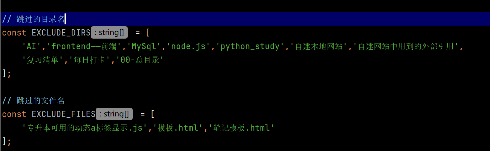

# 我的知识库

> 2025 年大专至今的个人学习笔记与备考记录 —— 以知识库的形式整理。

---

## 快速导航

- [Python 二级备考笔记](#python-完整体系)
- [计算机一级备考笔记](#计算机等级考试)
- [HTML/CSS 与 JavaScript](#前端)

---

## 关于该仓库

这是我 2025 年上大专至今积累的**个人知识库**，包含前端、计算机等级考试、Python 后端开发等学习内容。

---

## 包含的知识

### 前端
- **HTML / CSS**（已完结）
- **JavaScript**（学习进行中）

### 计算机等级考试
- **计算机一级（MS Office）**：备考记录、知识点整理
- **计算机二级（Python）**：备考笔记、错题归纳

### Python 完整体系
基于哔哩哔哩 UP 主「黑马程序员」课程，涵盖：

#### 第一部分 —— Python 启航
- 初识 Python
- 环境准备与 Python 安装
- 入门程序剖析

#### 第二部分 —— Python 核心语法（完整大纲）
- **数据存储与运算**（字面量、变量、标识符、字符串进阶、输入输出、运算符）
- **流程控制语句**（if 分支、match 模式匹配、while/for 循环）
- **数据容器**（列表、元组、字符串、集合、字典）
- **函数**（定义、参数、返回值、作用域、匿名函数、递归）
- **类型注释**（函数类型注释、变量类型注释）
- **模块与包**（导入方式、包机制、`__all__`、`sys.path`）
- **面向对象**（类、实例、属性、魔法方法、继承/多态/封装）
- **异常处理**（try-except、自定义异常、异常传递）
- **文件读写与操作**（open、读写模式、with 语句）

---

## 如何使用

### 在线访问（推荐）
- **Vercel 地址**：[https://my-web-plum-gamma-39.vercel.app/](https://my-web-plum-gamma-39.vercel.app/)  
  （动态加载稳定，推荐使用）

### 备用访问
- **GitHub Pages 地址**：[https://goldenfloweranddust.github.io/my_web/](https://goldenfloweranddust.github.io/my_web/)  
  （注意：GitHub Pages 上部分动态加载可能失败，若遇到此问题，请改用 Vercel 地址）

### 使用说明
- 单击链接即可进入主页，所有自学笔记已按类别整理在「博客」模块中。
- 计算机二级备考笔记使用导航栏+响应式设计，大部分内容通过动态加载显示，单击即可查看。
- 主页导航栏尚在设计中，目前暂时作为展示入口。

---

## 预览


---

## 更新日志

### 历史更新（2026-10-06 之前）

- 目前备考二级，持续补充笔记与错题归纳
- 定期优化导航与布局
- python 二级已经考完，后面大部分时间都是刷题，没有更新，但是大部分前 10 题都有所涉猎

### 2026-10-06 主要更新：专升本英语背单词体验

- 新增 Node.js 脚本 —— 生成 json 索引文件、重置每个板块日期（目前：1、3、7、15、30 天间隔复习）

- [英语单词复习清单](内容文件夹/专升本备考/备考专升本英语/复习清单/复习清单.html)

#### 联动逻辑

- **打勾**：复习清单点「✓ 已复习」后，该条目会记入当天的打卡记录（复习列）
- **新增**：新增一个词根 HTML 并跑完生成脚本后，打卡记录会自动出现「新增」项（以文件创建日期为准）
- **过滤**：被 `生成json索引.js` 排除的目录 / 文件（黑名单），不会进入 json，也就不会出现在打卡记录里

- 

#### 技术架构

- **data.json**：全局索引，由 Node.js 脚本（`生成json索引.js`）扫描目录自动生成
- **复习清单**：读取 data.json，展示今日任务，打勾后本地保存
- **打卡记录页**：按月读取 data.json 的 `created` 和 `lastReviewed` 字段，展示每日「新增」和「复习」
- **复习节奏**：1 / 3 / 7 / 15 / 30 / 60 / 90 天间隔重复
- **AI 协助实现代码，整体架构与学习逻辑为个人设计**

#### 主要更新文件

- [复习清单 - 文件夹](内容文件夹/专升本备考/备考专升本英语/复习清单)
- [每月复习文件夹](内容文件夹/专升本备考/备考专升本英语/每月打卡)
- [每月打卡汇总目录](内容文件夹/专升本备考/备考专升本英语/00-总目录/每月汇总.html)
- [复习清单——快速跳转](内容文件夹/专升本备考/备考专升本英语/复习清单/复习清单.html)

### 2026-10-07 小更新：优化任务分配与显示

**新增能力：**

- **配额自动错开**：`生成json索引.js` 新增 `DAILY_QUOTA` 配额机制。新增词根数量超过每日配额时，自动往后分配到后续日期，不再堆在同一天
- **复习次数显示**：任务卡片的 `Lv.X` 改为 `第N次` 徽章，并按次数分级着色（红 / 橙 / 绿），一眼看清每个词根的熟练度
- **进度不受影响**：以上改动只调整新词根的排期和显示样式，**已有词根的复习进度完全保留**

**使用提醒：**

| 想改什么 | 改哪里 |
|---|---|
| 复习间隔（1/3/7/15/30/60/90 天） | `复习打卡.js` 里的 `INTERVALS` 数组 |
| 每天任务数量 | `生成json索引.js` 里的 `DAILY_QUOTA` |
| 新增内容后 | 必须跑一次 `node 生成json索引.js` 更新 `data.json` |


### 2026-10-12 主要更新：数学模块

#### 新增内容

- **公式渲染**：笔记 HTML 里的 `$...$` 自动排版成数学公式
- **思维导图**：XMind 画好 → 跑脚本转 md → 网页自动渲染成可交互的树
- **自动转换脚本**：XMind → Markdown，公式自动加 `$`，中文自动包 `\text{}`

---

#### 用到的模块

| 模块 | 作用 |
|---|---|
| **KaTeX** | 网页公式渲染引擎 |
| **auto-render** | KaTeX 扩展，扫描页面自动找 `$...$` 并渲染 |
| **markmap** | 把 Markdown 列表渲染成可交互的思维导图（SVG） |
| **d3** | markmap 底层绘图库，负责缩放 / 拖动 |
| **xmind2md.py** | 自写脚本，读 `.xmind` → 输出层级化 `.md` |

---

#### 目录结构

```text
备考专升本数学/
 ├── 一些必备脚本/
 │    └── 数学公式js/
 │         ├── libs/                 ← 所有离线库（katex、d3、markmap）
 │         └── markmap-render.js     ← 思维导图渲染器（自写）
 ├── 基础知识/                        ← 各章节 HTML 笔记
 └── 思维导图准备/
      ├── mindmmap_xmind/            ← 放 .xmind 源文件
      ├── mindmmap_md/               ← 脚本自动生成的 md
      └── xmind2md.py                ← 转换脚本
```

---

#### 怎么用

**① 写公式**

| 场景 | 写法 |
|---|---|
| **HTML 里** | `$e^{x^2}$`（行内）或 `$$...$$`（独立） |
| **XMind 里** | 必须套 `\begin{aligned} ... \end{aligned}`，脚本才认得出 |

HTML 里引好 `katex.min.css` + `katex.min.js` + `auto-render.min.js`，加 `等待所有脚本执行后，渲染公式.js` 就自动渲染。

**② 画导图**

1. XMind 里画好 → 存到 `mindmmap_xmind/名字.xmind`
2. 跑 `python xmind2md.py`（自动生成 `mindmmap_md/名字/名字.md`）
3. HTML 里加 `<div data-mindmap="名字" style="height:400px;"></div>`
4. 引 `markmap-render.js`，刷新页面自动渲染

**③ 加新章节**

复制一个已有 HTML 改内容，路径按 `../../一些必备脚本/...` 写。

---

#### 注意事项

**① 命名必须一致**

> **文件夹名 = md 文件名 = `.xmind` 文件名 = `data-mindmap` 值**

四个必须完全一样，少一个渲染不出来。

**② XMind 里公式统一用 `aligned` 包**

- 所有公式节点，都写成 `\begin{aligned} ... \end{aligned}`
- 单行也要套，比如 `\begin{aligned} x = 1 \end{aligned}`
- 整段一行，`\\` 才是公式内换行，别按回车

**③ 中文和公式不混在一个节点**

- 要么纯公式，要么纯中文
- 想混就得在公式里用 `\text{}` 包中文（脚本也会自动帮你包）

**④ 相对路径不带 `内容文件夹/`**

- 只数"往上跳几层"，跳完直接从目标子目录开始写
- 带了 `内容文件夹/` 会因服务器根不同而 404

## 2026-10-19 更新：专升本数学与资料主页完善

- [初高中知识衔接](内容文件夹/专升本备考/备考专升本数学/初高中知识衔接)：完成模块一至模块八，均含知识精讲、典型例题、易错点、练习与答案，并提供 Markdown 和纯离线单文件 HTML——均由AI生成。
- [高等数学复习资料](内容文件夹/专升本备考/备考专升本数学/高等数学复习资料——均由AI生成)：按章整理第一至第十二章，统一 KaTeX 公式、深浅色主题、目录、打印与 PDF 样式——均由AI生成。
- **公式方案**：KaTeX 预渲染为 MathML，HTML 无需联网即可显示公式。
- **目录主页**：重构[专升本数学](内容文件夹/自建本地网站/导航栏内容/专升本/数学/专升本数学.html)与[专升本英语](内容文件夹/自建本地网站/导航栏内容/专升本/英语/专升本英语.html)入口页，加入搜索、卡片导航、主题记忆、阅读进度和响应式布局；原有内容、链接及 URL 均保持不变。

## 2026-10-29～10-30 更新：英语答疑、额外新增与国内入口

### 一句话架构

```text
本地 8767              → 分类、写 HTML、写 data.json
Cloudflare Worker + KV → 答疑、日志、待归档单词
香港 SCF 函数 URL      → 国内入口 → 现有 Cloudflare Worker
```

Cloudflare 仍是数据和 AI 的主系统；腾讯云 SCF 只是国内访问入口。

### 新增能力

- **AI 英语答疑**：单词解释、作文反例与修改、句子分析、语法问答。  
  入口：[英语答疑](内容文件夹/专升本备考/备考专升本英语/英语答疑/英语答疑.html)
- **单词解释自动收词**：答疑时识别目标单词；本地直接归档，云端进入待归档队列。
- **额外新增**：新词不占每天 20 个新词配额，第二天进入“额外新增”；没复习完继续保留。
- **删除插队**：已录入的词只提示，不再修改 `nextDate`、不再强制当天复习。
- **待归档单词**：云端导出 JSON → 本地 `导入待归档单词.bat` → 统一分类写入 HTML / `data.json`。
- **国内入口**：腾讯云 API 网关已停售，改用 **SCF 函数 URL**；香港函数作为反向代理，不需要服务器、域名或 API 网关。说明：[tencent-scf/README.md](内容文件夹/专升本备考/备考专升本英语/tencent-scf/README.md)
- **答疑历史**：云端记录可导出为 JSON，再导入本地日志；待归档单词和答疑记录是两份数据，互不影响。

### 当前数据（2026-10-30）

```text
核心词汇：307
复习词：312
全部词条：325
额外新增：deep、hello、heaven、nasty（10 月 31 日）
priority：0
```

核心页仍是 307，是因为 `deep` 是词根族、`hello` 等是原子词，不进入核心词族页。

### 关键文件

| 内容 | 文件 |
|---|---|
| 答疑页 | [英语答疑.html](内容文件夹/专升本备考/备考专升本英语/英语答疑/英语答疑.html) |
| 每日复习 / 额外新增 | [核心词汇复习清单.html](内容文件夹/专升本备考/备考专升本英语/复习清单/核心词汇复习清单.html) |
| 词库数据 | [data.json](内容文件夹/专升本备考/备考专升本英语/复习清单/data.json) |
| 本地自动归档 | [词汇代码生成器.html](内容文件夹/专升本备考/备考专升本英语/单词模块/词汇代码生成器.html) |
| 使用说明 | [使用指南.html](内容文件夹/专升本备考/备考专升本英语/使用指南.html) |
| Cloudflare 部署 | [cloudflare-worker/README.md](内容文件夹/专升本备考/备考专升本英语/cloudflare-worker/README.md) |
| 国内 SCF 入口 | [tencent-scf/README.md](内容文件夹/专升本备考/备考专升本英语/tencent-scf/README.md) |
| 本地工具说明 | [词素工具/README.md](内容文件夹/专升本备考/备考专升本英语/词素工具/README.md) |
| hello 原子词 | [原子词：hello.html](内容文件夹/专升本备考/备考专升本英语/词素/原子词/原子词：hello.html) |

### 云端与本地分工

- **本地 8767**：唯一负责分类和写词库的地方；生成器新增词直接进入“明天的额外新增”。
- **Cloudflare Worker + KV**：负责云端答疑、日志索引、待归档单词；入口地址和访问口令只存浏览器 localStorage。
- **国内 SCF**：只转发请求，不存词库、不分类；页面连接设置里可切换 `Cloudflare` / `国内 SCF`，两套地址和口令分别保存。
- **安全**：`词素工具/API.txt`、Cloudflare Token、SCF `PROXY_TOKEN` 不上传 GitHub，也不写进网页源码。

### 答疑导出与下载整理

| 导出 | 内容 | 导入 |
|---|---|---|
| 导出答疑记录 | 完整问题 + 回答日志 | `导入答疑记录.bat` → 本地 `英语问答日志/*.jsonl` |
| 导出待归档单词 | `word` + 原问题 + 时间 | `导入待归档单词.bat` → 分类写入词库 |

下载后运行 `整理云端下载.bat`，自动分到：

```text
云端下载/答疑归档
云端下载/待归档单词
```

浏览器不能自动分文件夹；这个 bat 只移动文件，不导入、不调用 AI。

### 响应式检查

已检查项目内 **40 个 HTML 页面**，在 `320 / 360 / 768 / 1200` 宽度下无横向溢出。

重点修复：

- 答疑历史记录：手机端标题和导出按钮改为上下排列，卡片增加 `min-width: 0` / `overflow: hidden`，长问题不再撑破容器。
- 每月打卡：日历改为 `repeat(7, minmax(0, 1fr))`，徽章可省略，不再把页面撑宽。
- `00-总目录` 三个页面补上 `viewport`。
- `语法体系/词素分类.html` 的对比表增加横向滚动容器。

### 使用顺序

1. 本地学习：启动 `启动词素服务.bat` → 打开[复习清单](内容文件夹/专升本备考/备考专升本英语/复习清单/核心词汇复习清单.html)。
2. 云端答疑：打开[英语答疑](内容文件夹/专升本备考/备考专升本英语/英语答疑/英语答疑.html)，线路选 `Cloudflare` 或 `国内 SCF`。
3. 加单词：云端导出待归档 → 本地导入；或直接用本地生成器。
4. 每天完成：`20 新 + 20 复习 + 额外新增`。